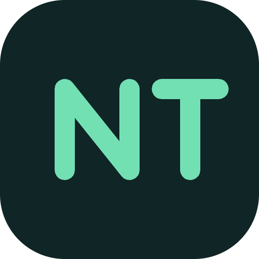

<p align="center">
  <a href="https://three-ntc.ben3d.ca" target="_blank" rel="noopener noreferrer">
    
  </a>
</p>
<br/>
<p align="center">
  <a href="https://npmjs.com/package/three-ntc"></a>
  <a href="https://www.npmtrends.com/three-ntc"></a>
  <a href="https://codecov.io/gh/bhouston/three-ntc"></a>
  <a href="https://discord.gg/fwupDN493R"></a>
  <a href="https://three-ntc.ben3d.ca/docs/getting-started/"></a>
</p>
<br/>

# three-ntc

> Neural Texture Compression for three.js and TSL.

- 🗜️ Whole PBR Stack in One Model
- 🎮 GPU Decoding via TSL
- 🧱 Standard three.js Node Material
- 🏋️ In-Browser GPU Trainer
- 🎚️ Selectable Sampling Modes

three-ntc is an implementation of NVIDIA's 2023 [Neural Texture Compression](https://research.nvidia.com/labs/rtr/neural_texture_compression/) paper. It encodes PBR material texture sets into a compact grid + MLP model that decodes on the GPU via TSL, and loads the result as a standard three.js node material. The materials pictured below, all textures combined, are about 93KB each, often smaller than a single texture from the original material.

[Read the Docs to Learn More](https://three-ntc.ben3d.ca/docs/getting-started/).

## Packages

| Package                                         | Version (click for changelogs)                                                                                                               |
| ----------------------------------------------- | :------------------------------------------------------------------------------------------------------------------------------------------- |
| [three-ntc](packages/three-ntc)                 | [](https://github.com/bhouston/three-ntc/releases)                 |
| [three-ntc-trainer](packages/three-ntc-trainer) | [](https://github.com/bhouston/three-ntc/releases) |

`three-ntc` is the runtime to depend on to load `.ntc` files; `three-ntc-trainer` trains a `.ntc` model from a MaterialX material or baked textures on the GPU. The repository also contains the demo site ([`packages/website`](packages/website)), the Docusaurus documentation ([`packages/docs`](packages/docs)), an embedded playground ([`packages/playground`](packages/playground)), and an unpublished command-line trainer stub ([`packages/cli`](packages/cli)).


Try it live at **[three-ntc.ben3d.ca](https://three-ntc.ben3d.ca)**. The [documentation website](https://three-ntc.ben3d.ca/) includes generated runtime and trainer API references, integration guides, an interactive demo and trainer, and a theory explainer.

## Usage

```js
import { NTCLoader, NTCNodeMaterial } from 'three-ntc';

const loader = new NTCLoader();
const { cpuModel, channelClassification } = await loader.loadAsync('gold.ntc');

const material = new NTCNodeMaterial(cpuModel, channelClassification);
const mesh = new THREE.Mesh(geometry, material);
```

## Development

```bash
corepack enable
pnpm install
pnpm dev
```

## Testing and quality gates

- `pnpm test` runs `tsc` then `vitest run --project unit --coverage`. Unit coverage
  includes all runtime and trainer TypeScript source, including GPU paths that unit
  tests don't execute. Gates are statements 19%, branches 13%, functions 18%, lines 19%,
  based on measured coverage rather than an artificial promise — raise them as CPU/GPU
  coverage improves, and don't lower them or exclude files just to pass.
- `pnpm test:gpu` runs the WebGPU suite in headless Chromium (`pnpm test:gpu:safari` for
  Safari). Hosted runners have no GPU, so CI falls back to SwiftShader software Vulkan;
  that job is advisory (`continue-on-error`) until it proves stable.
- `pnpm size` gates minified gzip ESM bundle size with `three` external: 11,000 bytes for
  `three-ntc`, 52,000 bytes for `three-ntc-trainer`. Explain intentional limit changes in
  the PR.
- `pnpm audit --prod --audit-level high` blocks CI on high/critical production
  dependency advisories. The full development audit currently reports two high-severity
  `extract-zip@2.0.1` advisories via WebdriverIO/Puppeteer with no patched registry
  release yet, so it stays advisory (`continue-on-error`) until one ships.
- `pnpm release:check` tests release-version analysis and packaging without publishing.

## Releases

See [RELEASING.md](RELEASING.md) for how releases are published and [GitHub Releases](https://github.com/bhouston/three-ntc/releases) for changes. See [SECURITY.md](SECURITY.md) for private vulnerability reports.

## Contribution

See [Contributing Guide](CONTRIBUTING.md).

## License

MIT

## Author

[Ben Houston](https://ben3d.ca), Sponsored by [Land of Assets](https://landofassets.com).
