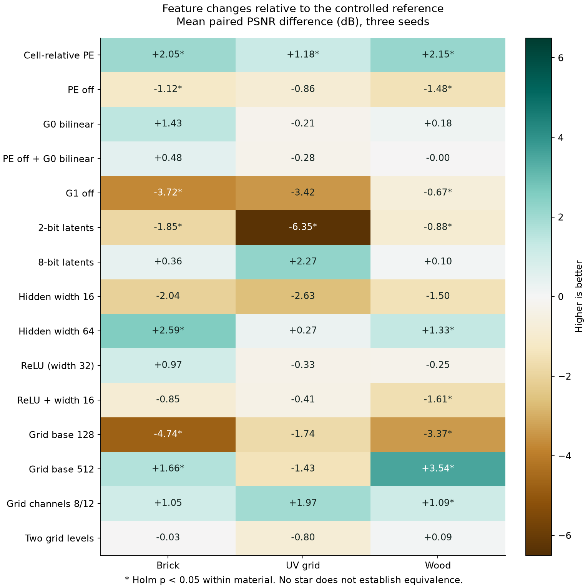
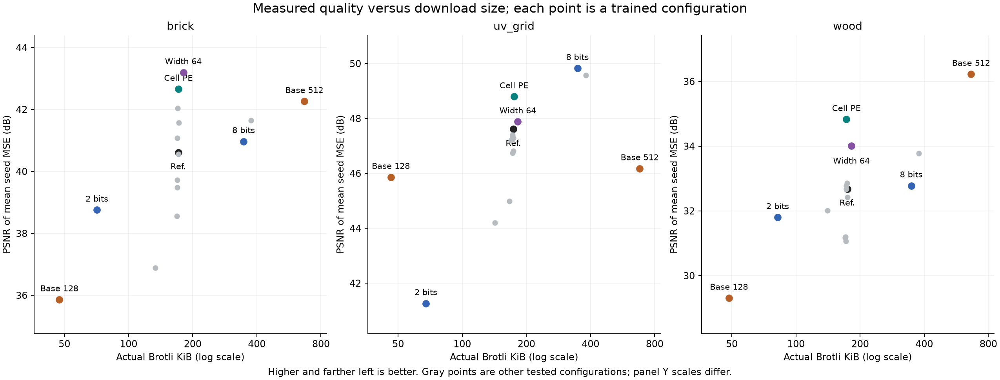

# Controlled feature experiments: findings and recommendations

2026-09-11 · 144 completed runs · brick, UV grid, and wood · three seeds per configuration.

**The strongest recommendation is to use cell-relative positional encoding as the next quality-profile baseline.** It improved all three materials, in every seed, with essentially unchanged storage and decoder size. Keep G1 and use 4-bit latents as the starting point for this representation. Larger grids, more channels, 8-bit latents, hardGELU, and wider networks are not universally beneficial. They should be selected against material quality and device constraints.

These findings support your concern about adopting the paper's settings wholesale. They support several of its underlying ideas—particularly positional information and the second grid—while favoring a different encoding coordinate system in this implementation. They do not yet identify the globally best codec or configuration for the web.

**What was measured and verified.** All **144/144 runs succeeded**, with no remaining failures: 16 configurations × three materials × three seeds. Each used 4,000 iterations, batch 4,096, and 1024² sources: 16,384,000 samples per run and 2,359,296,000 nominal samples overall. Recorded training time sums to 12.74 hours. The benchmark uses one Apple/Metal GPU and float gradient accumulation; this is not a cross-device performance study.

The shared reference uses G0/G1 channels 4/4, G0 widths 256/64/16/4, G1 widths 128/32/8/2, concatenated G0 taps, eight-texel positional encoding, two 32-neuron hardGELU layers, and 4-bit STE quantization. The source mip chain and remaining optimizer settings are held fixed. The earlier G0 noise-QAT discrepancy was corrected before this snapshot; every configuration here uses STE, so changing sampling does not change quantization method.

I verified accepted run counts, iteration/sample counts, matching source hashes across all 48 runs for each material, common adapter/precision, source/error checks, stored file sizes, and all gzip/Brotli model roundtrips. The 45 reference contrasts and their confidence intervals were independently recomputed from the raw seed scores. The source snapshot is `afc70a40f6977152453212f1a2b6d7ce0b6705f8df47e778df85c7cc8a8cb0fe`.

The primary score is exported-and-reloaded PSNR from range-normalized MSE over all classified-active components and the full mip chain. Numerically constant outputs retained by the classifier still count. Property scores and normal angular errors provide a check against misleading aggregate improvements. Checkerboard remains excluded because its prior bake was constant; road, rotate/scale, and velvet were not part of this screen.

**How to read the evidence.** The changes below are relative to the reference, averaged over paired seeds. Positive means the change helped; negative means it hurt. A +3.01 dB gain halves normalized MSE. Effects are conditional on this reference and training budget: they are not additive percentages of quality.

An asterisk marks a primary contrast passing Holm correction at 0.05 across the 15 planned reference comparisons **within that material**. The detailed report also gives unadjusted paired Student-t 95% intervals. Three seeds provide limited power and weak evidence about distribution shape. A result without an asterisk is not evidence of equivalence; the correction does not cover all property analyses, interactions, and cross-material claims as one global family.

| Change from reference | Brick ΔdB | UV grid ΔdB | Wood ΔdB | Main cost consequence |
| --- | ---: | ---: | ---: | --- |
| Cell-relative PE instead of eight-texel PE | **+2.05*** | **+1.18*** | **+2.15*** | Essentially unchanged bytes and MLP size |
| G0 bilinear instead of concatenated taps | +1.43 | −0.21 | +0.18 | Smaller decoder input; same latent storage |
| PE off | −1.12* | −0.86 | −1.48* | Small decoder saving |
| PE off + G0 bilinear | +0.48 | −0.28 | −0.00 | Smaller decoder; combined change |
| G1 off | −3.72* | −3.42 | −0.67* | 20% less resident grid data |
| 2-bit instead of 4-bit latents | −1.85* | −6.35* | −0.88* | 53–61% smaller Brotli files |
| 8-bit instead of 4-bit latents | +0.36 | +2.27 | +0.10 | Approximately twice the Brotli bytes |
| Hidden width 16 instead of 32 | −2.04 | −2.63 | −1.50 | About 61% fewer dense decoder MACs |
| Hidden width 64 instead of 32 | +2.59* | +0.27 | +1.33* | About 2.85–2.89× dense decoder MACs |
| ReLU instead of hardGELU, width 32 | +0.97 | −0.33 | −0.25 | Same MLP weight count; different activation cost |
| ReLU + width 16 | −0.85 | −0.41 | −1.61* | Smaller decoder; combined change |
| Base grid 128 instead of 256 | −4.74* | −1.74 | −3.37* | One quarter of the latent payload/residency |
| Base grid 512 instead of 256 | +1.66* | −1.43 | +3.54* | Four times the latent payload/residency |
| G0/G1 channels 8/12 instead of 4/4 | +1.05 | +1.97 | +1.09* | 2.2× latent payload/residency |
| Two feature levels instead of four | −0.03 | −0.80 | +0.09 | Only 0.39% fewer packed latent bytes |

**1. Cell-relative encoding is the best broadly useful improvement we measured.**

| Material | Reference mean PSNR | Cell PE mean PSNR | Paired gain and 95% interval | Geometric MSE reduction | Mean Brotli size, reference → cell PE |
| --- | ---: | ---: | --- | ---: | ---: |
| Brick | 40.61 | 42.66 | +2.05 dB [1.57, 2.54] | 37.7% | 171.3 → 171.4 KiB |
| UV grid | 47.62 | 48.80 | +1.18 dB [0.93, 1.43] | 23.8% | 173.7 → 174.9 KiB |
| Wood | 32.68 | 34.83 | +2.15 dB [1.57, 2.73] | 39.0% | 174.2 → 172.5 KiB |

This gain is not just better reconstruction of constants. Brick's albedo/normal property gains are +1.22/+3.17 dB. Wood improves albedo by +1.55, normals by +3.12, and roughness by +1.67 dB. UV-grid albedo improves by +1.20 dB. Mean mip-0 normal angular error falls from 1.58° to 1.27° for brick and 2.47° to 2.01° for wood.

Cell PE also wins at mip 0, by +1.47/+0.55/+1.26 dB for brick/UV/wood; its equal-mip gains are larger, +3.21/+2.24/+2.63 dB. This makes it attractive for minified views as well as the finest mip in this test.

The two encodings have the same 12-scalar width. In the code, cell PE uses `fract(uv * selectedG0Size - 0.5)`; the eight-texel version uses source-mip texel coordinates divided by eight. **My interpretation:** expressing location relative to the interpolation cell may make the decoder's local reconstruction task easier. That is a hypothesis consistent with the measurements, not a demonstrated mechanism or proof that eight-texel encoding is generally wrong. It should be checked at other source/base-resolution ratios.

The website already selects cell-relative encoding implicitly through period zero. This experiment supports retaining that choice. It does not validate every other website default, which differs in grid size, bit depth, decoder width, and activation.

**2. G1 earns its storage; concatenated G0 is less clearly necessary.** Removing G1 costs 3.72 dB on brick and 3.42 dB on UV grid for roughly 18–22% fewer Brotli bytes. Wood loses only 0.67 dB, making G1 removal a possible size tradeoff there. The UV effect is large and consistent in direction, but its Holm-adjusted p-value is 0.065, just above the predefined threshold. Retain G1 in the next general quality candidate; this test does not tell us the best G0/G1 channel allocation at a fixed total rate.

Switching G0 to bilinear improves brick by 1.43 dB and is close to the reference in the complete-chain aggregate for the other materials. It reduces dense decoder MACs from 2,400 to 2,016 for brick/wood (16%), and from 2,304 to 1,920 for UV grid (16.7%), without changing latent bytes. These are arithmetic counts, not measured runtime speedups.

However, wood exposes an important disagreement between metrics: bilinear G0 improves albedo by +0.68 dB and roughness by +0.96 dB, but worsens normals by −0.48 dB. Mean normal angular error rises from 2.47° to 2.72°, and aggregate mip-0 PSNR falls by 0.55 dB. It is premature to replace concatenation globally based on overall PSNR.

The PE × G0 interaction reinforces that caution. On wood, the measured advantage of concatenation is 1.30 dB greater with tiled PE than with PE disabled (unadjusted 95% interval +0.62 to +1.98). On brick and UV grid, those interaction intervals include zero. **Cell PE plus bilinear G0 was not tested.** Adding their individual gains would be unjustified.

**3. Bit depth should depend on content.** Moving from four to two bits gives substantial download savings, but its distortion cost varies sharply:

- Brick: −1.85 dB, about 1.53× MSE, with Brotli size falling from 171 to 71 KiB.
- Wood: −0.88 dB, about 1.23× MSE, from 174 to 82 KiB.
- UV grid: −6.35 dB, about 4.31× MSE, from 174 to 68 KiB.

For UV grid, the base-128/4-bit configuration achieves approximately 45.88 dB at 46 KiB; base-256/2-bit achieves 41.27 dB at 68 KiB. Shrinking the grid while preserving precision is better on both download size and quality among these measured points. It also uses one quarter of the resident grid data. For brick and wood, both reduced-grid and reduced-bit-depth configurations remain useful size/quality tradeoffs; they do not have matched sizes, so a universal efficiency ranking is inappropriate.

Eight bits roughly doubles download size. Brick gains only 0.36 dB and wood 0.10 dB. UV grid gains 2.27 dB, with a fairly wide interval [+0.85, +3.69] and Holm p=0.189. That is a worthwhile quality candidate to confirm, not a robust universal recommendation.

Keep four bits as the baseline for this paired-grid representation. Offer two bits as a small-file option for tolerant content, and test eight bits selectively for precise graphics. The experiment changes the standard zero-aligned quantizer, including its bit-dependent endpoint; it does not test arbitrary optimized quantization ranges. Both grids use the same precision here: mixed G0/G1 precision remains untested.

None of these precision changes reduces current resident grid memory: all three modes expand to RGBA16F. Their direct benefit is transport/storage size. They are not integer-weight inference modes.

**4. Decoder width contributes to quality, but hardGELU is not a universal winner.** Width 64 significantly improves brick (+2.59 dB) and wood (+1.33 dB); it adds only 0.27 dB on UV grid. The extra weights increase Brotli size by about 5%, but nearly triple dense decoder arithmetic. That can be a good offline-decoding or high-end choice; per-sample web inference needs actual frame-time measurements before promotion.

For wood, cell PE already exceeds width 64: 34.83 versus 34.01 dB at 172 versus 182 KiB. On brick, width 64 reaches 43.20 dB, about 0.54 dB above cell PE, for roughly 9.4 KiB more. Their combined configuration is untested. Apply the cheaper encoding improvement before assuming that a larger decoder is necessary.

Width 16 with hardGELU loses 1.50–2.63 dB. It saves decoder computation, but only a few percent of file bytes because latent grids dominate storage. It is a device-performance option, not the primary file-size control.

At width 32, ReLU's aggregate results are mixed and none passes the within-material Holm correction. At width 16, ReLU is much better than hardGELU for UV grid: the point-estimate difference is +2.22 dB. The activation × width interaction is −2.55 dB [−4.43, −0.66] on UV grid, using the report's “width-16 effect: hardGELU minus ReLU” orientation. This is exploratory interaction evidence, but sufficient reason to test activation and width together. Do not interpret the poor hardGELU/16 result as proof that all 16-wide networks are inadequate.

Normal-angle rankings differ again: on brick, ReLU/32 gives a mean 0.98° versus 1.58° for hardGELU/32, despite only a +0.97 dB aggregate change. Which output property matters to the final shading can affect the preferred activation.

**5. Increase spatial capacity selectively; preserve the inexpensive end of the pyramid.** Base 512 improves wood by 3.54 dB, including +4.39 dB for normals and +3.80 dB for roughness. It improves brick by 1.66 dB, predominantly through normals. But it worsens UV grid by 1.43 dB in the point estimate while quadrupling latent storage. That UV result does not survive Holm correction, but gives no reason to select the larger grid at this budget.

The base-resolution parameter scales **both grids at every level**, and changes their LOD-band mapping. These measurements therefore describe that complete parameter change, not an isolated increase in finest-G0 resolution. Larger models also receive fewer training samples per latent value at the same budget. Optimization limits and changed level assignment are possible explanations for nonmonotonic quality; neither has been isolated here.

The 8/12-channel setting costs 2.2× latent storage for gains of only 1.05/1.97/1.09 dB. On the observed size/error points, cell PE beats that setting for brick and wood. UV grid's 8-bit/4-channel setting has a better point estimate and smaller file than 8/12 channels. More channels should be a later tuning option, not an automatic paper-inspired default. This experiment does not separate the contributions of G0's and G1's added channels.

Reducing four feature levels to two saves just **680 packed latent bytes out of 174,760**. Quality differences are small or uncertain, with UV grid showing a −0.80 dB estimate. Keep four levels for now. The coarse levels are too small for removal to meaningfully improve download size; possible sampling or shader-compilation savings would need a separate runtime experiment.

**Measured rate–quality tradeoffs.**

The figure computes quality from mean seed MSE; the contrast tables average paired dB differences. Those aggregations differ slightly. Points are measured configurations, not fitted curves or claims about intermediate rates. Actual Brotli byte counts replace the earlier JSON-only comparison.

The main compression lesson is **representation choice can improve the achievable quality at a fixed rate more than simply allocating additional bits**. Cell PE changes no latent allocation; it outperforms several larger configurations. Conversely, the same extra bits have very different returns for UV graphics and wood. There is no single “bytes per PSNR” optimum, and three seeds cannot turn these finite-budget operating points into an information-theoretic limit.

**What I recommend next.**

| Decision | Recommendation | Evidence boundary |
| --- | --- | --- |
| Next quality-oriented baseline | Cell PE, base 256, G0/G1 channels 4/4, four levels, four bits, width 32 | This exact controlled configuration was measured; not a claim about the much smaller website bundle |
| G1 | Keep enabled by default in that candidate | Large brick/UV losses on removal; wood offers a possible size exception |
| G0 sampling | Retain concatenation in the measured candidate; test bilinear with cell PE next | Promising arithmetic saving, but wood normals regress and the combination is untested |
| Precision | Four-bit baseline; content-dependent two-/eight-bit options | UV grid particularly dislikes two bits |
| Decoder | Width 32 baseline; test ReLU/16 for a cheaper tier and width 64 for quality | Activation interacts with width; runtime measurements still needed |
| Grid size | Base 128 for lower-size candidates; reserve 512 for difficult detail such as wood | Larger grids are not consistently better at 4,000 iterations |
| Grid channels and tiny levels | Keep 4/4 channels and four levels initially | Extra channels are expensive; deleting tiny levels saves almost nothing |

The measured cell-PE candidate is obtained from the controlled reference by setting `positionalEncoding:true` and `positionalEncodingPeriod:0`. Its other settings matter: `g0Sampling:'concatenate'`, `dualGrid:true`, `baseResolution:256`, `levels:4`, `mipsPerLevel:2`, `gridChannels:4`, `lowResChannels:4`, `hiddenSizes:[32,32]`, `hiddenActivation:'hgelu'`, and STE uint4 with fixed range `[-0.5,0.4375]`. The experiment used 4,000 iterations, batch 4,096, learning rate 0.01, cosine floor 0.001, source mips, and 5% frozen-grid adaptation. Merely changing PE in a different preset is a new combination, not this measured result.

Before replacing any production defaults, I would do two targeted follow-ups:

1. **Test combinations around cell PE.** Prioritize cell PE + bilinear G0; cell PE + ReLU/32 and ReLU/16; and cell PE + width 64. Then test two/eight bits on the promising candidates. Use a concurrent cell-PE control and paired seeds in the new snapshot. Test rather than sum the individual effects.
2. **Validate selection outside the tuning set.** Compare the winning candidates against the actual library and website bundles on road, rotate/scale, and velvet at the same budget, with property/normal metrics and rendered checks. Include steady-state decoder time, startup/compile cost, and resident memory. Retry checkerboard only after its intended source normals are verified. Extend training on the finalists to test whether the rankings persist beyond 4,000 iterations.

The library baseline must remain in that comparison. Its previous single-seed UV-grid score was 53.67 dB, above every configuration's mean score in this paired-grid screen. That older result has a different snapshot and a different configuration bundle, so it is not a new paired contrast; it is a strong reason not to declare the best configuration within this screen globally optimal. Repeat it with three seeds alongside the finalists.

**My current assessment:** the most defensible change is the encoding coordinate system, followed by material-specific allocation of spatial resolution and precision. G1 has demonstrated value. Concatenated G0, hardGELU, and large decoders should be optional choices supported by measured property quality and runtime cost, rather than mandatory components inherited from the paper.

Full intervals, adjusted p-values, property deltas, and interactions are in [the detailed findings](feature-contributions-4000-v2-findings.md). The [dashboard](../output/benchmarks/feature-contributions-4000-v2/report.html) retains individual results and previews. This analysis has [derived measurements](benchmark-reports/feature-contributions-4000-v2/analysis-data.json) and a [reproduction script](benchmark-reports/feature-contributions-4000-v2/analyze.py); all original models and raw records remain in the benchmark directory.
