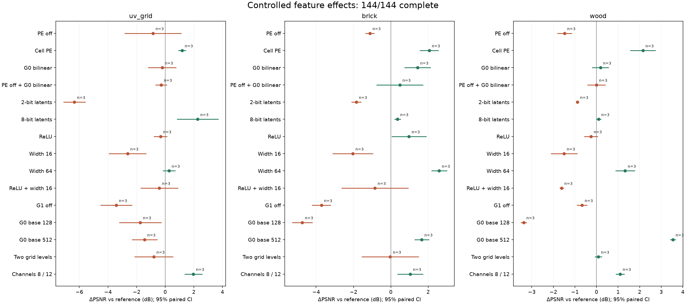

# Controlled feature study: findings

Updated from source `afc70a40f6977152453212f1a2b6d7ce0b6705f8df47e778df85c7cc8a8cb0fe`.

**Queue finished:** 144/144 successful; 0 failed; 0 pending. 4000 iterations, batch 4096, resolution 1024, seeds [1, 2, 3].

Every delta changes the named configuration relative to a shared reference: paired 4/4-channel grids, base 256, four levels, G0 concatenation, eight-texel PE, width 32 hardGELU, 4-bit STE. Source and optimizer settings are fixed. Width changes refer to both hidden layers.

**Interpretation:** positive ΔPSNR means the change helps; negative means the removed/replaced reference feature helped in this context. Capacity changes also change storage. These are conditional effects, not additive percentages or a ranking valid at every bitrate. Pairing checks source-mip hashes, snapshot, sample count, GPU and gradient precision.

Intervals are unadjusted paired Student-t 95% intervals across seeds. With three seeds they can be broad. Holm p-values adjust the primary reference contrasts within each material; interaction and property statistics remain exploratory. A complete-seed result with Holm p<0.05 is evidence within this study, not proof of generality. Missing cases are never imputed. Timing ratios include compilation and are not decoder performance.

A geometric MSE reduction is derived from the mean paired dB difference. Brotli sizes use quality 5 on the serialized model. Grid residency is RGBA16F texel accounting, not total process memory.

**uv_grid.mtlx**

| Change | ΔPSNR dB | 95% interval | Seeds | MSE reduction | Brotli ratio | Grid memory ratio | Holm p |
| --- | ---: | --- | ---: | ---: | ---: | ---: | ---: |
| 8-bit latents | +2.270 | +0.85 to +3.69 | 3/3 | +40.7% | 2.00× | 1.00× | 0.1886 |
| Channels 8 / 12 | +1.971 | +1.37 to +2.57 | 3/3 | +36.5% | 2.19× | 2.20× | 0.0644 |
| Cell PE | +1.182 | +0.93 to +1.43 | 3/3 | +23.8% | 1.01× | 1.00× | 0.0343 |
| Width 64 | +0.268 | -0.15 to +0.69 | 3/3 | +6.0% | 1.05× | 1.00× | 0.5878 |
| G0 bilinear | -0.210 | -1.17 to +0.75 | 3/3 | -5.0% | 0.99× | 1.00× | 0.6109 |
| PE off + G0 bilinear | -0.281 | -0.66 to +0.09 | 3/3 | -6.7% | 0.99× | 1.00× | 0.5878 |
| ReLU | -0.327 | -0.78 to +0.13 | 3/3 | -7.8% | 1.00× | 1.00× | 0.5878 |
| ReLU + width 16 | -0.406 | -1.68 to +0.87 | 3/3 | -9.8% | 0.97× | 1.00× | 0.6109 |
| Two grid levels | -0.795 | -2.14 to +0.55 | 3/3 | -20.1% | 1.00× | 1.00× | 0.5878 |
| PE off | -0.857 | -2.82 to +1.10 | 3/3 | -21.8% | 0.99× | 1.00× | 0.6020 |
| G0 base 512 | -1.435 | -2.29 to -0.57 | 3/3 | -39.1% | 3.92× | 4.00× | 0.1886 |
| G0 base 128 | -1.737 | -3.18 to -0.29 | 3/3 | -49.2% | 0.27× | 0.25× | 0.2837 |
| Width 16 | -2.626 | -3.91 to -1.34 | 3/3 | -83.1% | 0.96× | 1.00× | 0.1387 |
| G1 off | -3.419 | -4.51 to -2.33 | 3/3 | -119.7% | 0.82× | 0.80× | 0.0653 |
| 2-bit latents | -6.347 | -7.10 to -5.60 | 3/3 | -331.2% | 0.39× | 1.00× | 0.0113 |

Evidence passing the within-material correction: Cell PE improves quality by 1.18 dB; 2-bit latents reduces quality by 6.35 dB.

Paired mip-0 / equal-mip effects (dB): 8-bit latents +2.94 / +4.43; Channels 8 / 12 +2.10 / +2.33; Cell PE +0.55 / +2.24; Width 64 -0.06 / +1.02; G0 bilinear -0.97 / -0.74; PE off + G0 bilinear -0.96 / -0.79; ReLU -0.26 / -0.82; ReLU + width 16 -0.53 / -1.84; Two grid levels -0.69 / -0.00; PE off -1.76 / -0.96; G0 base 512 -2.02 / -3.30; G0 base 128 -1.97 / -0.89; Width 16 -2.76 / -2.46; G1 off -2.22 / -3.55; 2-bit latents -6.90 / -4.90.

Interaction: G0 concatenation benefit: tiled PE minus PE off: +0.786 dB, 3 paired seeds; 95% interval -1.504 to +3.077 dB.
Interaction: Width-16 effect: hardGELU minus ReLU: -2.547 dB, 3 paired seeds; 95% interval -4.430 to -0.663 dB.

Spatially varying property ΔPSNR (complete-chain error, paired mean dB; exploratory):

| Change | albedo |
| --- | ---: |
| 8-bit latents | +2.28 |
| Channels 8 / 12 | +1.97 |
| Cell PE | +1.20 |
| Width 64 | +0.26 |
| G0 bilinear | -0.19 |
| PE off + G0 bilinear | -0.25 |
| ReLU | -0.34 |
| ReLU + width 16 | -0.40 |
| Two grid levels | -0.80 |
| PE off | -0.85 |
| G0 base 512 | -1.44 |
| G0 base 128 | -1.74 |
| Width 16 | -2.61 |
| G1 off | -3.43 |
| 2-bit latents | -6.36 |

Complete-seed size/error frontier (point estimates, not confidence dominance): G0 base 128, ReLU + width 16, PE off + G0 bilinear, G0 bilinear, Reference, Cell PE, 8-bit latents.

**brick.mtlx**

| Change | ΔPSNR dB | 95% interval | Seeds | MSE reduction | Brotli ratio | Grid memory ratio | Holm p |
| --- | ---: | --- | ---: | ---: | ---: | ---: | ---: |
| Width 64 | +2.589 | +2.19 to +2.99 | 3/3 | +44.9% | 1.06× | 1.00× | 0.0156 |
| Cell PE | +2.054 | +1.57 to +2.54 | 3/3 | +37.7% | 1.00× | 1.00× | 0.0272 |
| G0 base 512 | +1.656 | +1.28 to +2.03 | 3/3 | +31.7% | 3.90× | 4.00× | 0.0272 |
| G0 bilinear | +1.430 | +0.75 to +2.11 | 3/3 | +28.1% | 0.99× | 1.00× | 0.0845 |
| Channels 8 / 12 | +1.045 | +0.37 to +1.72 | 3/3 | +21.4% | 2.20× | 2.20× | 0.1077 |
| ReLU | +0.972 | +0.06 to +1.88 | 3/3 | +20.1% | 1.01× | 1.00× | 0.1760 |
| PE off + G0 bilinear | +0.483 | -0.75 to +1.72 | 3/3 | +10.5% | 0.99× | 1.00× | 0.5263 |
| 8-bit latents | +0.361 | +0.21 to +0.51 | 3/3 | +8.0% | 2.03× | 1.00× | 0.0769 |
| Two grid levels | -0.032 | -1.54 to +1.47 | 3/3 | -0.7% | 1.00× | 1.00× | 0.9346 |
| ReLU + width 16 | -0.849 | -2.62 to +0.92 | 3/3 | -21.6% | 0.99× | 1.00× | 0.5263 |
| PE off | -1.123 | -1.35 to -0.90 | 3/3 | -29.5% | 0.99× | 1.00× | 0.0233 |
| 2-bit latents | -1.851 | -2.10 to -1.60 | 3/3 | -53.2% | 0.41× | 1.00× | 0.0132 |
| Width 16 | -2.036 | -3.10 to -0.97 | 3/3 | -59.8% | 0.98× | 1.00× | 0.0869 |
| G1 off | -3.720 | -4.21 to -3.23 | 3/3 | -135.5% | 0.78× | 0.80× | 0.0132 |
| G0 base 128 | -4.743 | -5.28 to -4.21 | 3/3 | -198.0% | 0.28× | 0.25× | 0.0102 |

Evidence passing the within-material correction: Width 64 improves quality by 2.59 dB; Cell PE improves quality by 2.05 dB; G0 base 512 improves quality by 1.66 dB; PE off reduces quality by 1.12 dB; 2-bit latents reduces quality by 1.85 dB; G1 off reduces quality by 3.72 dB; G0 base 128 reduces quality by 4.74 dB.

Paired mip-0 / equal-mip effects (dB): Width 64 +2.76 / +2.07; Cell PE +1.47 / +3.21; G0 base 512 +1.92 / +0.42; G0 bilinear +1.31 / +1.53; Channels 8 / 12 +1.01 / +1.43; ReLU +1.39 / +0.09; PE off + G0 bilinear -0.28 / +1.49; 8-bit latents +0.32 / +0.23; Two grid levels +0.09 / +0.15; ReLU + width 16 -0.76 / -1.13; PE off -1.99 / -0.01; 2-bit latents -1.75 / -1.41; Width 16 -2.26 / -1.09; G1 off -2.38 / -1.94; G0 base 128 -5.05 / -1.97.

Interaction: G0 concatenation benefit: tiled PE minus PE off: +0.175 dB, 3 paired seeds; 95% interval -0.958 to +1.308 dB.
Interaction: Width-16 effect: hardGELU minus ReLU: -0.215 dB, 3 paired seeds; 95% interval -1.536 to +1.107 dB.

Spatially varying property ΔPSNR (complete-chain error, paired mean dB; exploratory):

| Change | albedo | normal |
| --- | ---: | ---: |
| Width 64 | +2.43 | +2.70 |
| Cell PE | +1.22 | +3.17 |
| G0 base 512 | +0.61 | +2.92 |
| G0 bilinear | +1.18 | +1.70 |
| Channels 8 / 12 | +1.21 | +0.96 |
| ReLU | +0.26 | +1.65 |
| PE off + G0 bilinear | +0.88 | +0.15 |
| 8-bit latents | +0.37 | +0.38 |
| Two grid levels | -0.17 | +0.08 |
| ReLU + width 16 | -1.14 | -0.68 |
| PE off | +0.28 | -2.09 |
| 2-bit latents | -2.11 | -1.70 |
| Width 16 | -2.48 | -1.47 |
| G1 off | -4.68 | -2.79 |
| G0 base 128 | -4.53 | -4.98 |

Complete-seed size/error frontier (point estimates, not confidence dominance): G0 base 128, 2-bit latents, PE off + G0 bilinear, G0 bilinear, Cell PE, Width 64.

**wood.mtlx**

| Change | ΔPSNR dB | 95% interval | Seeds | MSE reduction | Brotli ratio | Grid memory ratio | Holm p |
| --- | ---: | --- | ---: | ---: | ---: | ---: | ---: |
| G0 base 512 | +3.545 | +3.43 to +3.66 | 3/3 | +55.8% | 3.81× | 4.00× | 0.0008 |
| Cell PE | +2.150 | +1.57 to +2.73 | 3/3 | +39.0% | 0.99× | 1.00× | 0.0351 |
| Width 64 | +1.327 | +0.89 to +1.77 | 3/3 | +26.3% | 1.05× | 1.00× | 0.0468 |
| Channels 8 / 12 | +1.095 | +0.91 to +1.28 | 3/3 | +22.3% | 2.16× | 2.20× | 0.0171 |
| G0 bilinear | +0.181 | -0.20 to +0.56 | 3/3 | +4.1% | 1.00× | 1.00× | 0.3924 |
| 8-bit latents | +0.098 | -0.00 to +0.20 | 3/3 | +2.2% | 1.99× | 1.00× | 0.2714 |
| Two grid levels | +0.088 | -0.06 to +0.24 | 3/3 | +2.0% | 0.99× | 1.00× | 0.3924 |
| PE off + G0 bilinear | -0.001 | -0.41 to +0.41 | 3/3 | -0.0% | 0.99× | 1.00× | 0.9943 |
| ReLU | -0.255 | -0.55 to +0.04 | 3/3 | -6.0% | 1.00× | 1.00× | 0.2714 |
| G1 off | -0.669 | -0.89 to -0.45 | 3/3 | -16.6% | 0.81× | 0.80× | 0.0468 |
| 2-bit latents | -0.882 | -0.92 to -0.84 | 3/3 | -22.5% | 0.47× | 1.00× | 0.0012 |
| PE off | -1.479 | -1.80 to -1.16 | 3/3 | -40.6% | 0.98× | 1.00× | 0.0258 |
| Width 16 | -1.499 | -2.10 to -0.90 | 3/3 | -41.2% | 0.98× | 1.00× | 0.0514 |
| ReLU + width 16 | -1.612 | -1.69 to -1.53 | 3/3 | -44.9% | 0.98× | 1.00× | 0.0015 |
| G0 base 128 | -3.373 | -3.50 to -3.25 | 3/3 | -117.4% | 0.28× | 0.25× | 0.0010 |

Evidence passing the within-material correction: G0 base 512 improves quality by 3.54 dB; Cell PE improves quality by 2.15 dB; Width 64 improves quality by 1.33 dB; Channels 8 / 12 improves quality by 1.09 dB; G1 off reduces quality by 0.67 dB; 2-bit latents reduces quality by 0.88 dB; PE off reduces quality by 1.48 dB; ReLU + width 16 reduces quality by 1.61 dB; G0 base 128 reduces quality by 3.37 dB.

Paired mip-0 / equal-mip effects (dB): G0 base 512 +3.35 / +1.91; Cell PE +1.26 / +2.63; Width 64 +1.24 / +1.13; Channels 8 / 12 +1.23 / +0.84; G0 bilinear -0.55 / +0.46; 8-bit latents +0.09 / +0.04; Two grid levels +0.05 / +0.12; PE off + G0 bilinear -0.95 / +0.68; ReLU -0.48 / -0.05; G1 off -0.56 / -0.88; 2-bit latents -1.01 / -1.12; PE off -2.34 / -0.47; Width 16 -1.88 / -1.19; ReLU + width 16 -2.27 / -0.85; G0 base 128 -4.01 / -2.17.

Interaction: G0 concatenation benefit: tiled PE minus PE off: +1.297 dB, 3 paired seeds; 95% interval +0.615 to +1.979 dB.
Interaction: Width-16 effect: hardGELU minus ReLU: -0.142 dB, 3 paired seeds; 95% interval -0.832 to +0.547 dB.

Spatially varying property ΔPSNR (complete-chain error, paired mean dB; exploratory):

| Change | albedo | normal | roughness |
| --- | ---: | ---: | ---: |
| G0 base 512 | +2.89 | +4.39 | +3.80 |
| Cell PE | +1.55 | +3.12 | +1.67 |
| Width 64 | +0.99 | +1.50 | +2.21 |
| Channels 8 / 12 | +1.24 | +1.01 | +0.87 |
| G0 bilinear | +0.68 | -0.48 | +0.96 |
| 8-bit latents | +0.13 | +0.07 | +0.09 |
| Two grid levels | +0.02 | +0.17 | +0.09 |
| PE off + G0 bilinear | +0.98 | -0.99 | +0.50 |
| ReLU | +0.03 | -0.61 | -0.00 |
| G1 off | -0.69 | -0.66 | -0.63 |
| 2-bit latents | -0.98 | -0.81 | -0.73 |
| PE off | -0.45 | -2.60 | -0.46 |
| Width 16 | -0.72 | -2.24 | -1.44 |
| ReLU + width 16 | -0.41 | -2.67 | -1.60 |
| G0 base 128 | -2.22 | -4.61 | -2.29 |

Complete-seed size/error frontier (point estimates, not confidence dominance): G0 base 128, 2-bit latents, G1 off, Two grid levels, Cell PE, G0 base 512.

**Recommendations for interpreting this screen.** Promote configurations only after all three seeds and source checks complete. Favor smaller configurations whose error meets the application threshold; do not turn a nonsignificant difference into an equivalence claim. Confirm finalists on road, rotate/scale and velvet, then measure rendered quality and decoder time. Keep checkerboard out until its source normal is verified. Extend training on finalists to distinguish capacity from optimization limits.

The plots show conditional paired deltas, not marginal effects averaged over a full factorial design. Property effects and raw numbers are in [feature-effects.json](benchmark-reports/feature-contributions-4000-v2/feature-effects.json); detailed errors and previews remain in the main dashboard.

