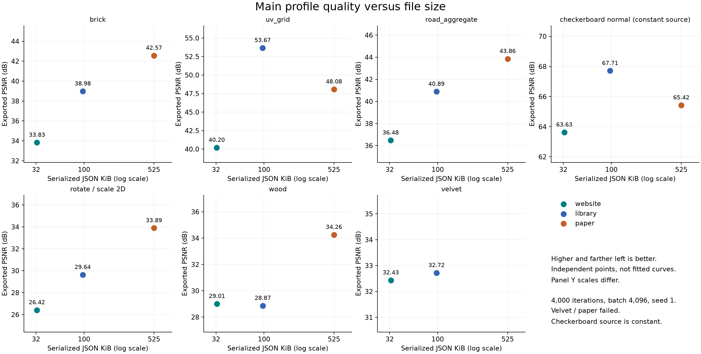
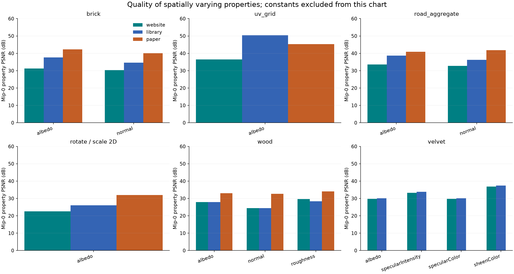

# Main-profile benchmark: quality, compression efficiency, and web recommendations

Analysis date: 2026-09-10. Dataset: `main-profiles-4000`, source snapshot `ff168d6f2bb8c987720a52c99b56ca9c7b47003d5ae92b9dbfedf6cb74c7b260`.

**Assessment.** Your concern is supported for the repository's current paper preset: it is an expensive default for the web, and smaller presets sometimes achieve better quality. But these measurements do **not** establish that the paper's feature formulation is intrinsically inefficient. We tested three different architecture and training bundles at one short training budget, rather than competing architectures at matched compressed sizes. The tested paper preset also differs from the paper's published bitrate configurations and quantization behavior.

I recommend keeping the small website preset as a download-oriented starting point, exposing a quality-oriented alternative, and selecting configurations per material against explicit quality and runtime limits. The next experiments should measure rate-distortion curves and fix the identified benchmark/fidelity issues before attributing gains to individual features.

**What actually completed.** There are **20 successful results out of 21**. Every successful model trained for 4,000 iterations with 4,096 samples per iteration: 16,384,000 samples, at 1024 × 1024, using seed 1 on Apple/Metal with float gradient accumulation. The paper/velvet browser connection closed unexpectedly; that run has no accepted final quality measurement. It is missing, not a zero-quality result. The generated dashboard's “IN PROGRESS” wording does not mean the queue is still training.

These are equal-sample-budget profiles. Native library, website, and paper iteration defaults are 3,000, 10,000, and 250,000; their batch defaults are 4,096, 8,192, and 524,288. Therefore this experiment does not measure their unmodified native training budgets. It measures what their representation and remaining optimizer settings deliver under our agreed 4,000 × 4,096 budget.

The analysis checks completed iterations, sample counts, source-load logs, GPU errors, and identical source-mip hashes between profiles for each material. It uses **exported and reloaded model** quality. No new training was performed for this report.

**Two caveats materially affect the conclusions.**

- `checkerboard_normal.mtlx` produced a constant reference in every active scalar component at every mip. Its normal X and Y are both zero throughout mip 0. The file contains a checkerboard-to-height-to-normal graph, but this bake does not capture a spatially varying normal. The 60–68 dB scores measure reproduction of constants. They must not be used as evidence that a profile preserves checkerboard detail. Whether this arises from derivative sampling, graph translation, or baking needs a focused source test; the metrics alone do not identify the cause.
- The channel classifier also retained numerically constant properties in other materials. For example, brick's roughness and specular properties are constant in the bake but count toward aggregate PSNR. Padding and properties already classified as constants are excluded; *all* constant-valued outputs are not. Consequently, per-property results and per-material comparisons are more meaningful than ranking different materials by aggregate PSNR.

The restored wood and velvet images loaded without recorded errors. Matching hashes establish consistency between profiles, not independent correctness of the MaterialX translation. The checkerboard finding demonstrates why both checks are needed.

**Measured quality and size.** The primary PSNR averages range-normalized squared error over active components and all texels in the complete mip chain. Signed normal components use range 2; other components use range 1. Higher is better. File sizes below mean the serialized JSON manifest, including base64 payloads and decoder weights; they are **not measured HTTP transfer sizes**.

| Material | Website PSNR | Library PSNR | Paper PSNR | Paper − library | Interpretation at this budget |
| --- | ---: | ---: | ---: | ---: | --- |
| brick | 33.83 | 38.98 | **42.57** | +3.59 dB | Paper reduces normalized MSE by 56.3% versus library |
| uv_grid | 40.20 | **53.67** | 48.08 | −5.59 dB | Library is smaller and has 3.62× lower MSE than paper |
| road_aggregate | 36.48 | 40.89 | **43.86** | +2.97 dB | Paper reduces MSE by 49.5% |
| checkerboard_normal | 63.63 | 67.71 | 65.42 | −2.29 dB | Constant source; exclude from detail-quality conclusions |
| standard_surface_rotate_scale2d_test | 26.42 | 29.64 | **33.89** | +4.25 dB | Paper reduces MSE by 62.5% |
| wood | 29.01 | 28.87 | **34.26** | +5.39 dB | Paper reduces MSE by 71.1%; website slightly beats library |
| velvet | 32.43 | **32.72** | Failed | — | Library gains only 0.28 dB over website |

All scores are dB, seed 1. “Paper” throughout means the repository's tested `getNTCPaperProfile` bundle.

| Storage or computation measure | Website | Library | Paper |
| --- | ---: | ---: | ---: |
| Serialized JSON, material-dependent | 32.6–32.9 KiB | 96.7–97.3 KiB | 524.5–525.1 KiB |
| Packed latent payload | 21,760 B | 69,904 B | 384,472 B |
| Resident latent texel data estimate | 174,080 B | 139,808 B | 1,537,888 B |
| Decoder parameters, 10-output material | 986 | 1,578 | 8,522 |
| Dense decoder multiply-accumulates/query, 10 outputs | 944 | 1,504 | 8,384 |

The last row is a shape-derived arithmetic count, excluding activation, sampling, packing, and GPU scheduling costs. It is not a measured shader time. The resident row is the benchmark's RGBA16F texel-data accounting, excluding allocation overhead, decoder storage, CPU copies, and total application memory.

Paper uses approximately **5.4× the JSON bytes, 5.5× the packed latent bytes, and exactly 11× the resident latent texel data of library**. Against website, its JSON is about 16× larger. Website's low-bit payload is smallest, but its expanded runtime grids actually occupy **24.5% more memory than library's**.

These are isolated operating points, not fitted rate-distortion curves. Each panel has its own vertical scale. On the size/primary-error axes, library strictly dominates paper for UV grid; website strictly dominates library for wood in this seed. Do not extend the latter claim to runtime memory, where library is smaller, or to statistical significance. For brick, road, and the rotate/scale test, all three points trade more bytes for less error. Paper's size alone does not make it dominated there.

For the **five nonconstant materials with all three results**—brick, UV grid, road, rotate/scale, and wood—the PSNR of the mean per-material normalized MSE is 30.68 / 32.85 / 37.47 dB for website / library / paper. Paper reduces that mean MSE by 65.5% versus library. This averages errors first, not dB; it is descriptive of these five chosen assets, with the difficult materials contributing most error. It is not a population estimate. Mean measured training times over the same subset are 247 / 190 / 731 seconds. Fixed profile order, one machine, and one seed make these timing observations provisional; training time is not decode time.

**What the material properties reveal.** The following values isolate important *output properties*, not causal contributions of architectural features. PSNR values here use mip 0 and average errors within each named property.

| Material / property | Website | Library | Paper |
| --- | ---: | ---: | ---: |
| brick albedo | 31.31 | 37.68 | 42.33 |
| brick normal XY | 30.36 | 34.57 | 40.03 |
| uv_grid albedo | 36.51 | 50.39 | 45.34 |
| road albedo | 33.60 | 38.74 | 40.92 |
| road normal XY | 32.76 | 36.26 | 41.83 |
| rotate/scale albedo | 22.61 | 26.00 | 31.94 |
| wood albedo | 27.86 | 27.87 | 32.98 |
| wood normal XY | 24.45 | 24.37 | 32.67 |
| wood roughness | 29.60 | 28.40 | 34.09 |
| velvet albedo | 29.83 | 30.09 | — |
| velvet specular intensity | 33.30 | 33.86 | — |
| velvet specular color | 29.83 | 30.08 | — |
| velvet sheen color | 36.89 | 37.48 | — |

Brick and road benefit in both color and normal reconstruction. Mean normal angular errors, website / library / paper, are **3.16° / 1.93° / 1.27°** for brick and **1.30° / 0.90° / 0.61°** for road. For wood they are **3.84° / 4.29° / 2.05°**. Thus the paper preset's wood improvement includes a substantial normal improvement, rather than merely a better average of unrelated channels. These means use the runtime's positive-hemisphere reconstruction; they do not bound worst-case highlight errors.

For UV grid, the library advantage remains when isolating albedo: it is not an artifact of constant roughness/specular channels. For rotate/scale, albedo accounts for over 99% of mip-0 normalized squared error in every profile. Wood's library error is approximately 53.5% normals, 35.8% albedo, and 10.6% roughness. In velvet, albedo and specular color together contribute about 85–86% of error; similar ranges and errors suggest checking their relationship before allocating independent decoder outputs, but do not prove they are identical.

The complete-chain metric gives mip 0 approximately 75% of its texel weight. Paper's road advantage drops from +2.97 dB overall to **+0.17 dB with equal weight per mip**. UV grid still favors library by **6.28 dB** under equal-mip weighting. Evaluate the LOD distribution a web scene actually displays; neither aggregate weighting is a substitute for that workload.

**Why bytes divided by PSNR is misleading.** PSNR is `−10 log10(D)` for our normalized MSE `D`. A gain of 3.01 dB halves MSE; a gain of 10 dB reduces it tenfold. Ratios of absolute dB scores have no corresponding reconstruction-quality meaning. For example, brick's 42.57 versus 38.98 dB is a 56.3% error reduction, not a 9.2% improvement in a linear quality quantity.

Changing the reference peak would add the same offset to both PSNRs without changing either reconstruction or their error ratio, yet it could change a bytes/PSNR ranking. Prefer **minimum bytes at a specified acceptable error**, **minimum error at a byte budget**, and the set of nondominated rate-distortion points. Incremental bytes per dB can describe a local measured tradeoff, but is not a universal efficiency score. Three differently configured points cannot establish a curve, an optimum, or a reliable matched-quality bitrate saving.

Shannon's rate-distortion framework asks for the minimum information rate needed to stay below an expected distortion for a specified source and distortion measure. It does not prescribe a neural architecture or imply that one representation is best for every material. Practical finite models, limited optimization, random-access requirements, and decoder cost add restrictions beyond the theoretical bound. Our results are achievable operating points for this implementation; they do not measure distance from a Shannon limit. [Shannon, *Coding Theorems for a Discrete Source With a Fidelity Criterion*](https://gwern.net/doc/cs/algorithm/information/1959-shannon.pdf).

Learned compression often optimizes an objective such as `D + λR`, jointly considering reconstruction error and a rate estimate. This repository instead allocates fixed grid dimensions/channel counts/bit depths and fits the content into them; changing the learned values generally does not shrink their fixed-width packed payload. A large grid can therefore store many bits without using them efficiently for an easy or poorly optimized material. Entropy-aware training is a possible later direction if a measured transport bottleneck justifies its complexity. [Ballé et al., *End-to-end Optimized Image Compression*](https://arxiv.org/abs/1611.01704).

For the web I would extend the selection problem to **minimize distortion subject to limits on download bytes, resident memory, decode milliseconds, and startup latency**. A weighted objective `D + λR + μTdecode + νMresident` is another formulation once units and product priorities are explicit. This is a proposed engineering objective, not a claim that Shannon's theorem supplies those runtime terms.

**What this says about the paper's features.** The [supplied paper](ntc_small_size.pdf), especially Sections 4–6 and Table 2, describes a compressed representation designed for random-access GPU decoding. It deliberately uses fixed-rate scalar quantization without entropy coding. Its paired grids divide work between high-resolution learned interpolation and lower-resolution smooth features. Sparse feature levels share storage across output mips. These are reasonable constraints and design choices; they are not a proof of optimality for browser shaders or this material set.

| Tested configuration | Website | Library | Paper |
| --- | --- | --- | --- |
| G0 widths | 128, 32 | 128, 32, 8, 2 | 256, 64, 16, 4 |
| G1 widths | 64, 16 | None | 128, 32, 8, 2 |
| G0 / G1 channels | 4 / 4 | 4 / none | 8 / 12 |
| G0 sampling | Four concatenated taps | Bilinear | Four concatenated taps |
| Positional encoding | Cell phase | Off | Eight-texel period |
| Hidden layers | 16, 16; ReLU | 32, 32; ReLU | 64, 64; hardGELU |
| Exported latent precision | 2 bits | 8 bits, without QAT | 4 bits |
| Training mip source | Source box chain | Source box chain | Rebuilt Lanczos chain |

All these variables move together, alongside optimizer differences. We cannot infer that G1, hardGELU, or positional encoding caused a particular gain or loss. In particular, website already uses paired grids, concatenated G0, and encoding; success of that small preset does not argue against those mechanisms.

There are three concrete reasons to avoid equating this run with a reproduction of the paper:

1. **The tested bitrate is different.** The paper's NTC 0.2 configuration uses 8 G0 channels at 2 bits and 12 G1 channels at 4 bits. Our helper uses 4 bits on both grids. At these exact grid dimensions, its 384,472-byte latent payload would become **244,664 bytes** with the paper's mixed precision: 36.4% fewer latent bytes. That is a storage calculation, not a measured quality prediction. It would still be 3.5× library's latent payload. A preset's advertised BPPC also depends on source resolution, channel count, mip accounting, and weight overhead; “NTC 0.2” cannot be transferred literally to every MaterialX asset.
2. **The quantization path is not faithful.** In the benchmark snapshot, concatenated G0 hard-rounds values even when noise QAT is requested, while G1 uses noise. This affects website and paper. The discrepancy was established in the earlier [implementation review](latent-grid-paper-review.md) and remains visible in the snapshot. Its impact on these quality rankings is unknown until measured after correction.
3. **Optimization differs substantially.** The paper describes 250,000 iterations of eight 256² crops; our run uses 4,000 iterations of 4,096 samples. That is 8,000× fewer nominal samples than the paper helper's full budget, with different sampling structure. Equal samples answer our practical budget question, not convergence quality. Paper also trains against Lanczos mips while evaluation uses the common box chain. That difference may contribute to coarse-mip error, but it cannot fully explain UV grid: paper is also worse at mip 0.

The paper uses specialized GPU matrix operations; this implementation expresses inference through Three.js/TSL. A decoder width that is attractive on the paper's execution path may be expensive here. We have arithmetic counts and estimated grid memory, not measured web decode throughput across devices, so the size concern is established more firmly than the runtime performance ranking.

**Where the bytes actually go.** For a pair at level `j`, packed latent bits are `Wj*Hj*C0*b0 + (Wj/2)*(Hj/2)*C1*b1`. Halving both grid dimensions quarters that level's payload; changing bit depth scales it linearly. Fourfold spacing between feature levels reduces area by 16 each time, so the full hierarchy costs only about **6.7% more than the finest pair**. The finest pair accounts for approximately 93.75% of this paper preset's latent bytes. Removing its last two tiny levels would save only **1,496 bytes, or 0.39%**, while potentially damaging coarse LODs.

The main storage targets are therefore **finest G0/G1 resolution, channel allocation, and bit depth**, rather than deleting the small end of the pyramid. G0 alone accounts for 72.7% of the tested paper latent payload. Mixed G0/G1 precision is particularly relevant.

Decoder simplification serves a different immediate purpose. At ten outputs, changing the paper network to width 16 while keeping its input shape would save 14,304 raw weight bytes, only about 3.6% of its current combined latent-and-weight payload. It could save much more arithmetic. Removing positional encoding or replacing hardGELU barely changes storage directly; their compression benefit must come from reaching a quality target with fewer latent bits. Experiments should distinguish direct byte savings, decode savings, and improved quality per latent bit.

Current runtime expansion weakens the connection between low bit depth and GPU memory savings. Quantized values become RGBA16F grids: 2-bit, 4-bit, and 8-bit storage do not remain 2-, 4-, and 8-bit resident representations. Packing to groups of four channels introduces additional constraints. This makes resident-format work an independent opportunity from architecture tuning.

JSON/base64 overhead is also separate. For brick/paper, raw latent bytes plus FP16 weights total **401,516 bytes**, versus **537,710 serialized JSON bytes**. Binary packaging could remove much of that difference without changing reconstruction. Actual Brotli/gzip savings cannot be derived from these records: the benchmark retained byte counts, not the exported manifests. Future runs should save the models and measure compression explicitly. A transport entropy layer can be decompressed once at load time while retaining random access afterward; directly sampling entropy-coded latents is a different, harder design problem.

**Recommended next steps, in priority order.**

1. **Repair the evidence gaps first.** Retry only failed paper/velvet against the same immutable snapshot. Separately investigate checkerboard's constant reference and validate its intended nonflat normals at more than one resolution or sampling offset. Preserve this dataset; corrected source or trainer behavior belongs in a new snapshot. Add expected-content checks alongside missing-image checks. Correct the G0 noise path with targeted coverage, then label subsequent results as a new implementation version.
2. **Improve measurement before a broad sweep.** Save exported models; record raw payload, binary container, JSON, gzip/Brotli, resident memory, shader compilation/startup, and GPU decode timing. Keep per-property errors and add rendered comparisons under fixed lights, views, roughness-sensitive highlights, and minification. Audit constant-output extraction, including duplicated or derivable properties. Keep old aggregate metrics for continuity and add clearly named varying-property and render metrics.
3. **Run a small rate sweep around useful configurations.** Begin with brick, UV grid, and wood: they show a quality gain, a paper regression, and a strong small-preset result. Use 4,000 iterations and batch 4,096 initially, with three matched seeds and randomized run order. Sweep latent 2/4/8 bits at a fixed architecture; then G0 base widths 64/128/256 at fixed bit depth. Add mixed G0/G1 2/4 bits once supported. These are unsigned quantizer codes representing ranged floats, not integer-weight inference. Retain the best size/error points and expand those to the remaining valid materials.
4. **Attribute features on top of that rate sweep.** Compare PE off/cell/eight-texel encoding, G0 bilinear/concatenated sampling, G1 off/on, and ReLU/hardGELU at otherwise matched settings. Compare hidden widths 16/32/64 separately. Use matched-byte configurations where feasible, or compare interpolated quality only over overlapping measured rate ranges. Test PE × G0 sampling and activation × width interactions explicitly; feature gains need not add up. Report paired seed differences with uncertainty, not percentages of “total quality contribution.”
5. **Check optimization sensitivity for finalists.** Retrain selected configurations at 4,000/16,000/64,000 iterations with each schedule defined in advance; hold batch and source constant. This tests whether UV grid's paper regression or other outcomes persist when optimization is extended. Do not assume the last stochastic loss values establish convergence. Report both equal-sample and equal-wall-time views, and label native-budget runs separately.
6. **Choose web presets by constraints.** For current download-oriented choices, website is especially attractive for wood and velvet; library is compelling for UV grid; paper is a quality option for brick, road, rotate/scale, and wood when its size is acceptable. These are provisional asset-specific choices. Benchmark decoder width, latent residency, and sampling on representative desktop and mobile hardware before assigning runtime tiers. Do not automatically replace the website default with the paper helper.
7. **Include conventional and procedural alternatives.** Compare equivalent material maps and mip chains encoded with KTX2/Basis Universal, with correct color/normal handling and runtime transcode targets. KTX2 separates distribution formats from GPU-resident formats and supports supercompression, making it a relevant web baseline. For simple procedural content, also measure retaining the graph or storing constants directly. A neural representation need not win every asset. [Khronos KTX overview](https://www.khronos.org/ktx/), [KTX 2 specification](https://registry.khronos.org/KTX/specs/2.0/ktxspec.v2.html).

The practical decision rule should be: **choose the smallest deliverable that passes the material's quality thresholds and the target device's runtime limits**. This dataset supports building that selector and a smaller paper-inspired option. It does not yet justify removing a particular feature from the architecture.

**Evidence and reproducibility.** Raw results, logs, and the immutable training snapshot remain in [the benchmark directory](../output/benchmarks/main-profiles-4000/). The [dashboard](../output/benchmarks/main-profiles-4000/report.html) provides previews and detailed mip metrics. This report preserves its [derived measurements](benchmark-reports/main-profiles-4000/measurements.json) and [analysis/plot script](benchmark-reports/main-profiles-4000/analyze.py); run the script with Python and matplotlib to regenerate them from the raw results. The report does not alter training defaults, retry failed cases, or claim significance from a single seed. The seven requested materials are a selected diagnostic set, not a representative sample of all web materials.
