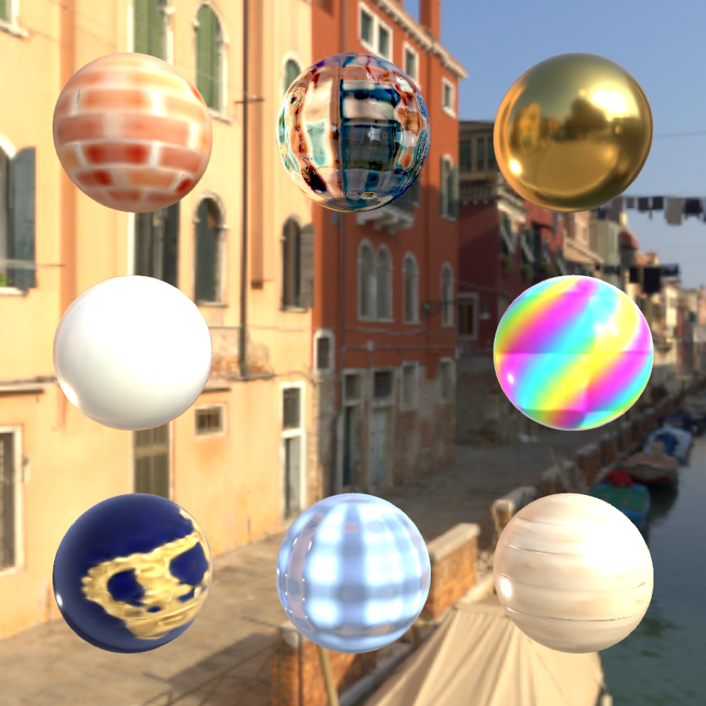

<p align="center">
  <a href="https://three-ntc.ben3d.ca" target="_blank" rel="noopener noreferrer">
    
  </a>
</p>
<br/>
<p align="center">
  <a href="https://npmjs.com/package/three-ntc"></a>
  <a href="https://www.npmtrends.com/three-ntc"></a>
  <a href="https://codecov.io/gh/bhouston/three-ntc"></a>
  <a href="https://discord.gg/fwupDN493R"></a>
  <a href="https://three-ntc.ben3d.ca/docs/getting-started/"></a>
</p>
<br/>

# three-ntc

> Load Neural Texture Compression materials in three.js.

- 🗜️ Compact `.ntc` Material Files
- 🎮 GPU Decoding via TSL
- 🧱 Extends `MeshPhysicalNodeMaterial`
- 🎚️ Selectable Sampling Modes

Load `.ntc` files and get back a standard node material that decodes a compact grid + MLP model on the GPU. `.ntc` models are trained with the companion [`three-ntc-trainer`](https://www.npmjs.com/package/three-ntc-trainer) package.

[Read the Docs to Learn More](https://three-ntc.ben3d.ca/docs/getting-started/).



Try it live at **[three-ntc.ben3d.ca](https://three-ntc.ben3d.ca)**.

`.ntc` models are trained with the companion [`three-ntc-trainer`](https://www.npmjs.com/package/three-ntc-trainer) package.

## Install

```bash
npm install three-ntc
```

## Usage

```js
import { NTCLoader, NTCNodeMaterial } from 'three-ntc';

const loader = new NTCLoader();
const { cpuModel, channelClassification } = await loader.loadAsync('gold.ntc');

const material = new NTCNodeMaterial(cpuModel, channelClassification);
const mesh = new THREE.Mesh(geometry, material);
```

`NTCNodeMaterial` extends three.js's `MeshPhysicalNodeMaterial`, so it drops straight into an
existing WebGPU renderer scene alongside ordinary materials.

## Runtime sampling

```ts
const material = new NTCNodeMaterial(cpuModel, channelClassification, {
  samplingMode: 'nearest', // default
  lodBias: 0,
});

// Sampling changes rebuild the TSL graph and compile a specialized shader on next use.
material.setSamplingMode('stochastic'); // or 'nearest' / 'trilinear'
material.samplingMode = 'nearest'; // equivalent property setter
material.setLodBias(1); // live uniform; positive bias selects finer mips
```

| Mode         | MLP evaluations per material sample | Behavior                                                                                                       |
| ------------ | ----------------------------------- | -------------------------------------------------------------------------------------------------------------- |
| `nearest`    | 1                                   | Reconstruct the nearest physical texel at the nearest mip.                                                     |
| `stochastic` | 1                                   | Randomly select a texel and mip with trilinear sampling probabilities. Noise varies by screen pixel and frame. |
| `trilinear`  | 8                                   | Reconstruct and blend four texels at each of two mip levels.                                                   |

Sampling mode is a JavaScript build-time choice, not a shader uniform. Each shader
contains only its selected sampling path. Changing the property or calling the setter
rebuilds the material's channel nodes and marks it for recompilation. Selecting the
same mode again does nothing. Existing grid textures, decoder parameters, UV/LOD
settings, and debug view are retained; training updates still upload in place.

Stochastic sampling follows the paper's UV/LOD jitter approach. It introduces noise;
this library and the website currently apply no temporal reconstruction. Its expected
material-channel values match trilinear filtering, but averaging shaded samples is
not equivalent to shading averaged material channels. Add a temporal resolve in the
renderer when using this mode for stable images.

The old `interpolation` option and `setInterpolation()` have been replaced by
`samplingMode` and `setSamplingMode()`. Sampling controls runtime reconstruction,
not the training model or its learned G0/G1 feature interpolation. Settings are not
stored in `.ntc` exports. `setLodBias()` affects automatic LOD only; an explicit
constructor `lodNode` takes precedence. The website viewer and trainer preview both
expose sampling and LOD bias controls and start with nearest sampling.

## Contribution

See [Contributing Guide](https://github.com/bhouston/three-ntc/blob/main/CONTRIBUTING.md).

## License

MIT

## Author

[Ben Houston](https://ben3d.ca), Sponsored by [Land of Assets](https://landofassets.com).
